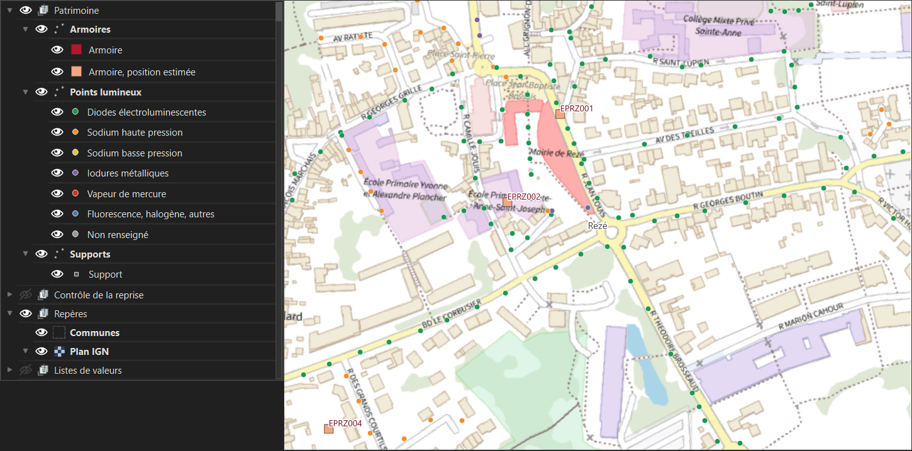
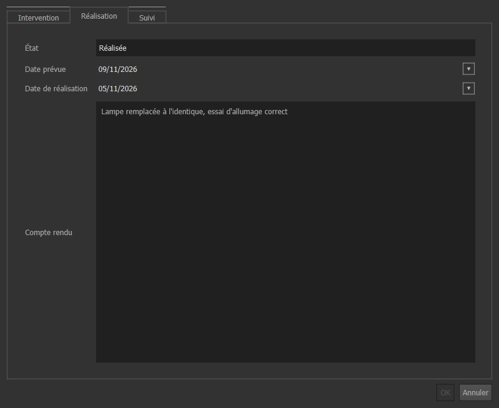

# Reprise d'inventaires d'éclairage public au géostandard EclExt

Trois inventaires publiés par des gestionnaires différents, amenés dans une même base PostgreSQL/PostGIS, exportés au format national [EclExt v1.1](https://cnig.gouv.fr/IMG/pdf/cnig_eclext_v1_1.pdf) (CNIG, 2022), contrôlés de bout en bout, et exploitables dans QGIS par trois profils d'utilisateurs.

Ce projet prolonge [recette-geo](https://github.com/jauresmas/recette-geo), mon outil de contrôle des livraisons géographiques. recette-geo dit si un fichier reçu est recevable ; ici, je me mets de l'autre côté : c'est moi qui reprends les données et qui dois tenir mes comptes.

Toutes les données sont ouvertes. Le travail est indépendant et n'engage aucun des producteurs.

## Ce que la reprise a révélé

| | SDE18 (Cher) | Nantes Métropole | Publication Loire | Total |
|---|---:|---:|---:|---:|
| Lignes source | 63 093 | 97 473 | 18 147 | 178 713 |
| Points lumineux repris | 63 093 | 97 473 | 18 104 | 178 670 |
| Supports | 63 093 | 92 093 | 18 104 | 173 290 |
| Armoires | 3 698 | 1 982 | 0 | 5 680 |
| Lignes fusionnées / écartées | 0 / 0 | 0 / 0 | 33 / 10 | 33 / 10 |
| **Lignes sans explication** | **0** | **0** | **0** | **0** |

- **Une publication titrée « Loire » décrit la Haute-Savoie.** La publication « Éclairage public sur le département de la Loire » annonce le département 42, mais ses 18 104 points sont rattachés à 56 communes de Haute-Savoie. Les données ne disent pas pourquoi. La règle `POS_05` bloque le lot, et l'anomalie reste à signaler au producteur.
- **Aucun point n'est entièrement conforme au standard.** Aucune des trois sources ne donne tous les attributs obligatoires. Rien n'a été inventé pour y arriver : la fiche de métadonnées de chaque lot se déclare non conforme, et recette-geo refuse les trois lots.
- **Deux publications du même patrimoine divergent.** Dans le Cher, la communauté de communes Cœur de France publie une partie des objets du syndicat. Le rapprochement apparie 5 347 objets, trouve 14 recodages probables (AY-0699 devenu SOL-0699), 15 objets présents d'un seul côté et 21 positions écartées de plus de 5 m.
- **Les erreurs courantes sont comptées, pas effacées.** 17 757 écarts relevés, dont 12 549 hauteurs à 0, 2 347 températures de couleur inexploitables, 33 lignes coupées à l'export et reconstituées, 4 identifiants portés chacun par deux objets.

Le détail est dans le [rapport de reprise](docs/rapport_reprise.pdf).

## Ce que contient le dépôt

| Besoin | Réponse | Où |
|---|---|---|
| Une base structurée | Armoire, départ, support, point lumineux ; clés étrangères, contraintes, listes de valeurs du standard, audit | `sql/01` à `03`, `40` |
| Une reprise relançable | SQL commenté, utilisable dans DBeaver ; correspondances dans une table relue | `sql/10` à `13`, `data/correspondances/` |
| Des contrôles de reprise | Bilan ligne à ligne, relecture indépendante des sources, 36 règles, déplacements au centimètre | `sql/30` à `32`, `livrables/controle/` |
| Un contrôle indépendant | Cahier EclExt pour recette-geo, qui relit les fichiers livrés sans passer par la base | `recette_geo/cahier_eclext.yaml`, `livrables/recette_geo/` |
| Une seconde voie de reprise | Le cœur de la reprise de Nantes refait au modeleur graphique de QGIS, comparé objet par objet à la voie SQL | `modeles/reprise_nantes_eclext.model3`, `scripts/08b_modele_qgis.py` |
| Des outils de consultation | Trois projets QGIS : fiches en onglets, fiches liées, recherches enregistrées, thèmes de carte | `projets/` |
| Des comptes par profil | Administrateur, collectivité, entreprise, lecture : droits et périmètre garantis par la base (RLS), pas par le projet QGIS | `sql/41_roles.sql` |
| Un flux de mise à jour | Comparaison de deux publications ; un objet absent est retiré et daté ; une correction locale n'est pas écrasée | `flux.comparer_lots` dans `sql/01_structure.sql`, `tests/test_7_flux.py` |
| Un cahier de recette | Tests automatiques et vérifications manuelles, avec leurs résultats | `livrables/recette/cahier_recette.xlsx` |
| Des supports de formation | Un guide par profil, un aide-mémoire administrateur, un plan de formation | `docs/*.pdf` |

## Trois profils dans QGIS



La collectivité consulte sa commune et signale une panne. L'entreprise met à jour ses interventions, sans pouvoir changer la nature d'une intervention ni sauter une étape. L'administrateur voit tout, traite les écarts et affecte les signalements. Quand un point change de matériel, la base inscrit le nouveau matériel à la clôture de l'intervention et garde l'ancien dans son journal.



## La méthode

```text
Publications ouvertes (avec empreinte)
    |  02 : chargées telles quelles, en texte, avec le numéro de ligne
    v
  src.*  --03 : correspondances, reprise-->  metier.*  --05 : export-->  EclExt (CSV, GeoPackage, métadonnées)
                                                |                              |
                                                |  04 : bilan, règles,         |  06 : recette-geo
                                                v       rapprochement          v
                                          controle.ecart                   décision de recevabilité
                                                ^
                                                |  décisions du gestionnaire dans QGIS
```

- **Rien n'est perdu.** Reprises + fusionnées + écartées = lignes du fichier, et le contrôle est bloquant.
- **Rien n'est inventé.** 92 correspondances, chacune classée certaine, déduite ou arbitrée. Une valeur inconnue ressort en écart. Un attribut absent reste vide. Les hypothèses retenues (un inventaire courant est supposé en service, la date de pose d'un support vaut date de validité dans le Cher) sont écrites attribut par attribut dans `ref.origine_attribut`.
- **Rien n'est corrigé en silence.** La valeur lue et la valeur retenue sont gardées ; le gestionnaire confirme ou écarte, et sa décision survit aux passes suivantes.
- **Deux voies, un résultat.** Sur 97 465 objets de Nantes, le modèle graphique et le SQL ne donnent aucune différence sur le type de source, le support, la puissance et la température, ni sur la position. La comparaison compte aussi les valeurs renseignées, pour qu'un zéro ne soit pas un zéro vide.

## Les limites

- **Aucun contrôle de terrain.** Les données sont comparées entre sources et au référentiel des communes ; un inventaire peut être cohérent et faux.
- **Les signalements et interventions sont un jeu d'essai.** Aucune source ne publie d'historique de maintenance. Ce jeu sert à tester les fiches et les droits. Chaque ligne porte `jeu_essai = true` et n'entre dans aucun attribut exporté.
- **Un point par support dans le Cher.** Le syndicat ne publie que ses supports. L'hypothèse est marquée sur chaque point ; Nantes, qui publie la hiérarchie complète, compte 1,058 foyer par support, ce qui donne l'ordre de grandeur de l'erreur.
- **Positions d'armoires estimées.** Aucune source ne les publie : elles sont calculées au centre des supports alimentés, et marquées comme telles.
- **Cinq arbitrages à faire valider** par un gestionnaire (liste dans le rapport, section 5).
- **Base de démonstration.** Locale, sans mot de passe. L'aide-mémoire dit ce qu'il faut régler avant de l'ouvrir à d'autres postes.
- **Le déplacement des données de la Loire n'est pas expliqué.** Je constate, je n'explique pas.
- **Vérifications manuelles à dérouler.** Les parcours sont testés par scripts et dans une vraie fenêtre QGIS, mais les vérifications T-MAN du cahier de recette, avec de vrais utilisateurs, restent à faire.

## Relancer le projet

Il faut PostgreSQL 15 avec PostGIS 3, QGIS 3.34, Python 3.10 ou plus et [recette-geo](https://github.com/jauresmas/recette-geo). Les chemins sont réglés dans `scripts/config.py`.

```bash
pip install -r requirements.txt
```

```bash
cd scripts
```

```bash
python run_all.py --telecharger
```

La chaîne crée une base dédiée (port 5436), télécharge les publications du jour, reprend, contrôle, exporte, construit les projets QGIS et le modèle, déroule les tests, écrit le cahier de recette et imprime les documents. Les publications changent : les chiffres ci-dessus sont ceux de la collecte du 5 novembre 2026, dont les empreintes sont dans `flux.lot`. La base, les fichiers source, les exports EclExt et les registres d'anomalies ne sont pas versionnés, car ils sont volumineux : la chaîne les recrée.

Le parcours dans une vraie fenêtre QGIS se lance à part, dans un QGIS ouvert sur un projet vide, depuis la console Python :

```python
chemin = r"chemin\vers\scripts\09_captures_qgis.py"
exec(open(chemin, encoding="utf-8").read(), {"__file__": chemin})
```

### Copier la base dans un serveur PostgreSQL existant

La chaîne et les tests travaillent sur l'instance dédiée du projet. Pour avoir la base dans un serveur déjà installé (même version de PostGIS), double-cliquer sur `copier_vers_mon_postgres.bat`. Le mot de passe du serveur est demandé à l'écran, sans être affiché ni enregistré.

Le script crée la base `eclext`, les rôles `ep_*` et les comptes `demo_*`, compare les tables une à une avec l'origine et vérifie qu'un compte reste dans son périmètre. Il n'écrase pas une base `eclext` existante, sauf avec `--remplacer`. Les mots de passe tirés au hasard pour les comptes de démonstration sont dans `data/comptes_demo.txt`, et les projets QGIS qui visent ce serveur dans `projets/mon_postgres/`. Ces deux éléments ne sont pas versionnés.

## Les sources

| Publication | Producteur | Rôle |
|---|---|---|
| [Supports d'éclairage public du SDE18](https://www.data.gouv.fr/fr/datasets/673b1255be2baa1d2a71c950/) | Syndicat départemental d'énergie du Cher | Reprise |
| [Luminaires d'éclairage public de Nantes Métropole](https://www.data.gouv.fr/fr/datasets/626888d1110b508648f11a3b/) | Nantes Métropole | Reprise |
| [Éclairage public sur le département de la Loire](https://www.data.gouv.fr/fr/datasets/65a53c04c6b2ecabaf745104/) | Loire Forez Agglomération | Reprise |
| [Inventaire intercommunal de l'éclairage public](https://www.data.gouv.fr/fr/datasets/6920fea1ae83a56f12a19776/) | Communauté de communes Cœur de France | Témoin du rapprochement |
| [API Découpage administratif](https://geo.api.gouv.fr/decoupage-administratif) | État | Contours communaux |

Le fond de plan des projets QGIS est le Plan IGN (Géoplateforme).

## Licences

Code et documents du dépôt sous [licence MIT](LICENSE). Les données restent sous la licence de leur source (Licence Ouverte 2.0). recette-geo, utilisé pour le contrôle, est un projet séparé sous licence GPL.
